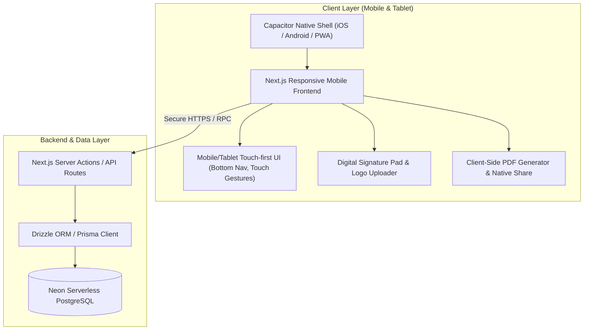

# Billu - Architecture & Invoice Specification

## 1. System Architecture

### Tech Stack Breakdown:
1. **Frontend**: Next.js 14/15 App Router (React), Mobile & Tablet optimized viewport (`<meta name="viewport" content="width=device-width, initial-scale=1, maximum-scale=1, user-scalable=no, viewport-fit=cover">`).
2. **Mobile Runtime**: Capacitor (`@capacitor/core`, `@capacitor/cli`, `@capacitor/share`, `@capacitor/haptics`, `@capacitor/filesystem`).
3. **Database**: Neon Serverless PostgreSQL with Drizzle ORM (type-safe, lightweight, instant queries with connection pooling).
4. **Styling & Design System**: Modern mobile-first CSS design system with touch targets (min 44px), smooth animations, haptic cues, dark & light mode support, and tablet master-detail split layout.
5. **Export & Sharing**: In-app PDF generation and native OS share sheet (WhatsApp, Email, Save to Files, Print).

---

## 2. Comprehensive Bill / Invoice Fields (Researched)

Based on commercial invoicing best practices (GST/VAT compliant, professional grade), a complete bill contains:

### A. Business Profile (Seller)
- **Company Name & Logo**
- **Business Address & Phone / Email**
- **Tax Identification Number** (e.g. GSTIN, PAN, VAT, EIN, depending on country)
- **Payment / Bank Details**: Bank Name, Account No, IFSC/IBAN/Routing, UPI ID / QR code

### B. Client Information (Buyer)
- **Client / Business Name**
- **Contact Info**: Phone Number, Email
- **Billing & Shipping Address**
- **Client Tax ID** (optional for B2B)

### C. Invoice Header & Metadata
- **Invoice Number**: Auto-generated sequential format (e.g. `INV-0001` with customizable prefix)
- **Invoice Date**: Issue date (defaults to today)
- **Due Date / Payment Terms**: (e.g. Immediate, Net 7, Net 15, Net 30)
- **Status**: Paid, Pending / Unpaid, Partially Paid, Overdue

### D. Line Items (Products & Services)
- **Product / Service Name & Description**
- **HSN / SAC Code** (optional tax code)
- **Quantity & Unit of Measurement** (pcs, hrs, kg, box, etc.)
- **Unit Price / Rate**
- **Discount per Item** (% or flat)
- **Tax Rate per Item** (e.g. 0%, 5%, 12%, 18%, 28% or customizable)
- **Line Item Total**

### E. Financial Calculations & Summary
- **Subtotal** (sum of item costs before tax/discount)
- **Overall Discount** (if applicable)
- **Tax Breakdown** (e.g. CGST + SGST, IGST, or single Tax)
- **Shipping / Additional Handling Fees** (optional)
- **Round-off Adjustment** (for clean cash totals)
- **Grand Total** (highlighted prominently)
- **Amount in Words** (e.g., *"Seven Thousand Four Hundred Only"*)

### F. Legal, Verification & Footer
- **Terms & Conditions / Return Policy**
- **Customer Notes / Thank You Note**
- **Authorized Signatory**:
  - Uploaded signature image OR
  - **Live touch-screen finger signature canvas** (draw signature right on phone/tablet)
- **Company Stamp / Seal** (optional image upload)

---

## 3. Core Modules & User Flows

1. **Dashboard**: Quick metrics (Total Sales, Pending Dues, Recent Invoices), Quick Create Bill FAB.
2. **Product Catalog**: Add/edit products, default pricing, tax rates, inventory units.
3. **Client Directory**: Add/edit clients, contact info, billing address, past purchase history.
4. **Bill Creator (Mobile Touch Wizard)**:
   - Step 1: Select client (or add on the fly) + Invoice dates
   - Step 2: Add line items (quick search from catalog with auto-fill, qty counter buttons)
   - Step 3: Discounts, Taxes & Payment Notes
   - Step 4: Digital signature & live preview
   - Step 5: Save, generate PDF, and share directly via WhatsApp / Native Share
5. **Invoice Management**: Filter by status (Paid / Unpaid), search, download PDF, mark payment received.
6. **Company Settings**: Configure company name, address, tax number, logo, default terms, bank details & UPI ID.
